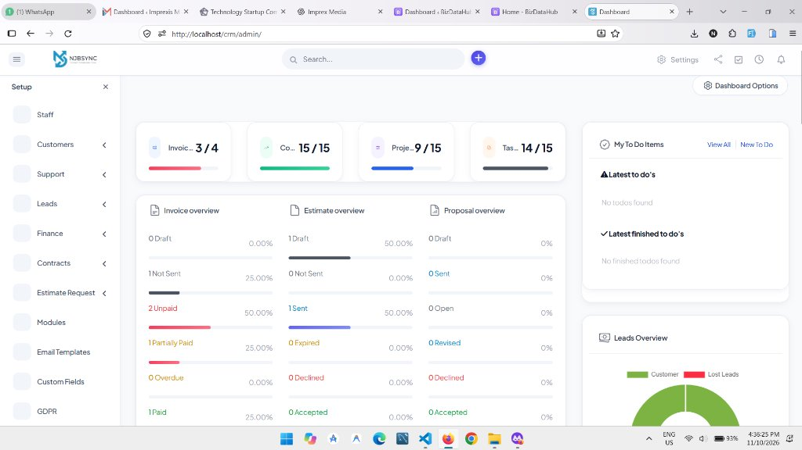

<div align="center">

# 🚀 Modern Open-Source CRM Application
### High-Performance Self-Hosted Business Management Platform • Version 1.0

[](https://github.com/)
[](https://www.php.net/)
[](https://codeigniter.com/)
[](https://www.mysql.com/)
[](LICENSE)
[](https://github.com/)

<br />

**A full-featured, self-hosted enterprise Customer Relationship Management (CRM) application with modern UI styling, prominent sidebar navigation, and streamlined workflow management.**

[Key Features](#-key-features) • [Screenshot](#-dashboard-preview) • [Installation Guide](#-installation-guide) • [Folder Structure](#-directory-structure) • [License](#-credits--license)

</div>

---

## 📸 Dashboard Preview

<div align="center">



*Modern dashboard featuring prominent sidebar icons, quick KPI stat cards, financial overview, and task management.*

</div>

---

## 🌟 Key Features

### 👥 Customer & Contact Management
* **Comprehensive Client Dossier**: Centralize customer records, communication logs, billing history, and active projects.
* **Dedicated Client Portal**: Secure client interface allowing customers to review proposals, pay invoices online, track tickets, and upload project files.
* **Multiple Contacts**: Manage multiple points of contact per client account with custom role-based permissions.

### 🎯 Leads & Sales Pipeline
* **Kanban Pipeline**: Visual drag-and-drop board for tracking leads across stages.
* **Web-to-Lead Forms**: Easily embed customizable lead generation forms on your websites.
* **One-Click Conversion**: Convert qualified leads directly into active customer accounts.

### 💰 Invoicing, Estimates & Payments
* **Multi-Currency Invoicing**: Generate professional invoices with automatic tax and discount calculations.
* **Online Payment Integration**: Pre-configured support for popular online payment gateways and offline bank transfers.
* **Recurring Billing**: Automate subscriptions and recurring invoicing schedules.
* **Estimates to Invoices**: Convert accepted client estimates into invoices with a single click.

### 📁 Project & Task Management
* **Milestone Tracking**: Break down large deliverables into structured milestones.
* **Integrated Time Tracking**: Built-in stopwatch timers to track billable work and push recorded hours to client invoices.
* **Gantt & Kanban Views**: Visualize project roadmaps and team workload distribution.

### 📝 Contracts & Digital Proposals
* **Interactive Proposals**: Create structured proposals with customizable item tables and client feedback.
* **Electronic Signatures**: Collect binding electronic signatures directly in the client portal.
* **Contract Expiry Alerts**: Automated notifications before contracts require renewal.

### 🎫 Support Ticket System
* **Department Queues**: Route incoming tickets to appropriate support teams.
* **Email Piping**: Automatically convert incoming customer emails into support tickets.
* **Canned Responses & Internal Notes**: Streamline team communication and speed up resolutions.

### 📈 Business Analytics & Reports
* **Profit & Loss Analytics**: Real-time visual comparison of income and expenses.
* **Tax Summaries**: Generate clear tax liability reports for financial accounting.
* **Staff Performance Reports**: Monitor logged billable hours and completed tasks.

### 🔒 Security & Extensibility
* **Granular Role-Based Access (RBAC)**: Define precise permissions for administrators, project managers, and staff members.
* **Two-Factor Authentication (2FA)**: Additional account security using Google Authenticator.
* **Custom Fields System**: Extend any module with custom input fields without database alterations.

---

## 📋 System Requirements

* **PHP:** `8.1` or `8.2` (PHP 7.4+ supported)
* **Database:** MySQL `5.7+` or MariaDB `10.3+`
* **Web Server:** Apache (with `mod_rewrite` enabled) or Nginx
* **Required PHP Extensions:** `curl`, `gd`, `mbstring`, `openssl`, `pdo_mysql`, `zip`, `xml`, `bcmath`, `fileinfo`
* **Memory Limit:** `128M` minimum (`256M` recommended)

---

## 🛠️ Installation Guide

### Option 1: Local Setup (XAMPP / WAMP / LAMP)

1. **Clone or Download the Repository:**
   ```bash
   git clone https://github.com/najeebahmad07/crm.git c:\xampp\htdocs\crm
   ```

2. **Start Web & Database Servers:**
   * Open the XAMPP Control Panel.
   * Start **Apache** and **MySQL**.

3. **Create Database:**
   * Open `http://localhost/phpmyadmin` in your browser.
   * Create a new database named `crm` (Collation: `utf8mb4_unicode_ci`).

4. **Configure Database Credentials:**
   * Copy `application/config/app-config-sample.php` to `application/config/app-config.php`.
   * Open `application/config/app-config.php` and configure your local settings:
     ```php
     define('APP_BASE_URL', 'http://localhost/crm/');

     define('APP_DB_HOSTNAME', 'localhost');
     define('APP_DB_USERNAME', 'root');
     define('APP_DB_PASSWORD', '');
     define('APP_DB_NAME', 'crm');
     define('APP_ENC_KEY', 'your-random-32-char-encryption-key-here');
     ```

5. **Access the CRM:**
   * Open your browser and navigate to:
     ```
     http://localhost/crm/admin/
     ```

---

### Option 2: Linux / VPS Server (Ubuntu / Nginx / Apache)

1. **Clone to Web Root:**
   ```bash
   cd /var/www/
   git clone https://github.com/najeebahmad07/crm.git crm
   cd crm
   ```

2. **Set File & Folder Permissions:**
   ```bash
   chown -R www-data:www-data /var/www/crm
   chmod -R 755 /var/www/crm
   chmod -R 777 /var/www/crm/uploads
   chmod -R 777 /var/www/crm/temp
   chmod -R 777 /var/www/crm/application/config
   ```

3. **Apache VirtualHost Configuration (`/etc/apache2/sites-available/crm.conf`):**
   ```apache
   <VirtualHost *:80>
       ServerName crm.yourdomain.com
       DocumentRoot /var/www/crm

       <Directory /var/www/crm>
           Options FollowSymLinks
           AllowOverride All
           Require all granted
       </Directory>
   </VirtualHost>
   ```

4. **Nginx Server Block Configuration (`/etc/nginx/sites-available/crm`):**
   ```nginx
   server {
       listen 80;
       server_name crm.yourdomain.com;
       root /var/www/crm;
       index index.php index.html;

       location / {
           try_files $uri $uri/ /index.php?$query_string;
       }

       location ~ \.php$ {
           include snippets/fastcgi-php.conf;
           fastcgi_pass unix:/var/run/php/php8.2-fpm.sock;
       }
   }
   ```

---

## ⏱️ Cron Job Configuration

To automate recurring invoices, overdue notifications, and support ticket checks, configure a server Cron job:

```bash
# Run every 5 minutes
*/5 * * * * php /var/www/crm/index.php cron/index
```

Or through cPanel Cron Jobs:
```
wget -q -O- https://yourdomain.com/crm/cron/index >/dev/null 2>&1
```

---

## 📁 Directory Structure

```plaintext
crm/
├── application/
│   ├── config/             # Database and application environment configs
│   ├── controllers/        # Core business and API controllers
│   ├── helpers/            # Menu, asset, and general helpers
│   ├── models/             # Database query and entity models
│   ├── views/
│   │   ├── admin/          # Admin portal views and widget modules
│   │   ├── authentication/ # Modern login and account security views
│   │   └── themes/perfex/  # Client portal templates and interfaces
├── assets/
│   ├── css/
│   │   └── custom.css      # Modern UI styling and component enhancements
│   ├── js/                 # Client and admin interactive scripts
│   └── plugins/            # DataTables, Chart.js, FontAwesome, etc.
├── modules/                # Modular extension directory
├── screenshots/            # Showcase images and dashboard previews
│   └── dashboard.jpg       # Dashboard preview screenshot
├── uploads/                # User avatars and attachments
├── .gitignore              # Git repository ignore rules
├── LICENSE                 # MIT Open Source License
├── README.md               # Documentation and showcase guide
└── index.php               # Application entrypoint
```

---

## 🎨 UI Architecture

All custom styling rules, modern sidebar icon styling, and card layouts are centralized in:

[`assets/css/custom.css`](assets/css/custom.css)

This clean separation ensures core controllers, models, and application logic remain standard, clean, and reliable while giving full styling flexibility.

---

## 👨‍💻 Credits & License

* **Developer:** **Najeeb**
* **Version:** **1.0**
* **License:** [MIT License](LICENSE)

---

<div align="center">

Made with ❤️ by **Najeeb** • Version 1.0

</div>
