<div align="center">

# 🚀 Modern Open-Source CRM Application
### High-Performance Self-Hosted Business Management Platform • Version 1.0

[](https://github.com/najeebahmad07/crm)
[](https://www.php.net/)
[](https://codeigniter.com/)
[](https://www.mysql.com/)
[](LICENSE)
[](https://github.com/najeebahmad07)

<br />

**A complete, self-hosted, enterprise-grade Customer Relationship Management (CRM) application with a modern UI, prominent sidebar navigation, and streamlined workflow management.**

[Screenshots Gallery](#-screenshots-gallery) • [Features A to Z](#-features-a-to-z) • [Installation Guide](#-installation-guide) • [Directory Structure](#-directory-structure) • [License](#-credits--license)

</div>

---

## 📸 Screenshots Gallery

<div align="center">

### 1. 🔒 Authentication & Login Portal
*Glassmorphic card design with ambient background mesh, floating rounded inputs, and secure authentication.*

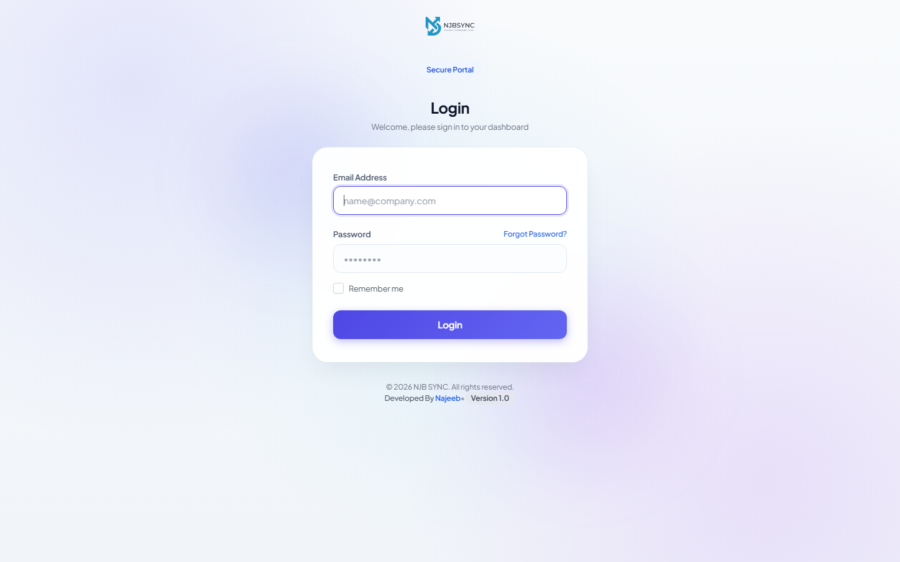

<br />

### 2. 📊 Executive Admin Dashboard
*Prominent sidebar icons, quick KPI cards with colored gradient badges, financial summaries, and task widgets.*

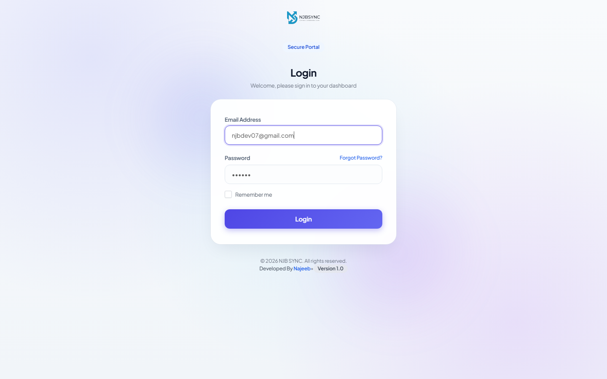

<br />

### 3. 👥 Customer Management
*Full client directory with contacts, statements, projects, invoices, and dedicated client portal.*

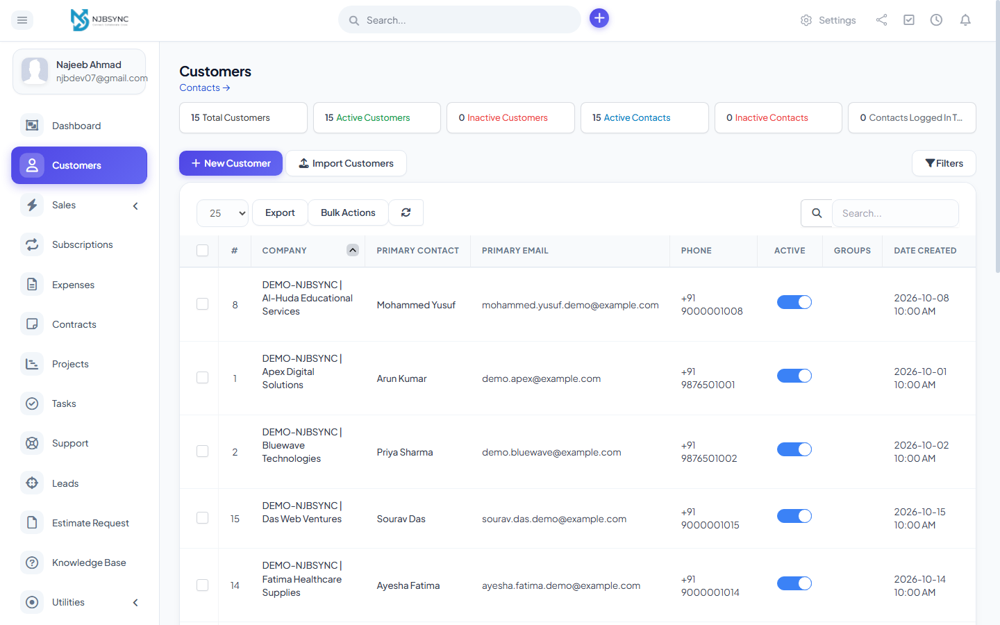

<br />

### 4. 🎯 Leads & Sales Pipeline
*Visual Kanban pipeline for tracking leads, conversion stages, and automated lead capture.*

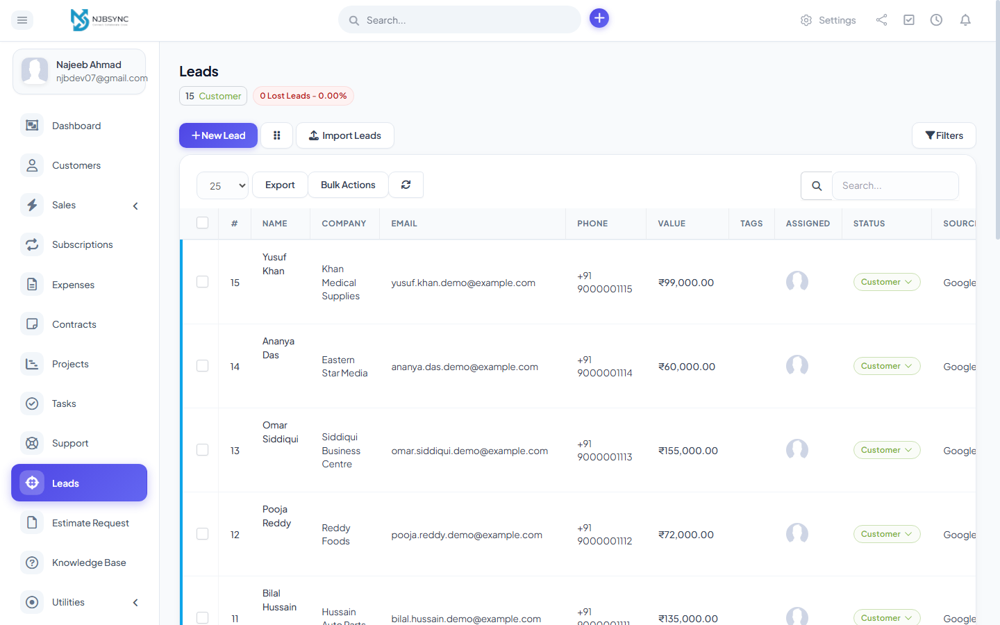

<br />

### 5. 💰 Invoices & Billing
*Multi-currency invoicing, payment tracking, automated recurring cycles, and instant PDF generation.*

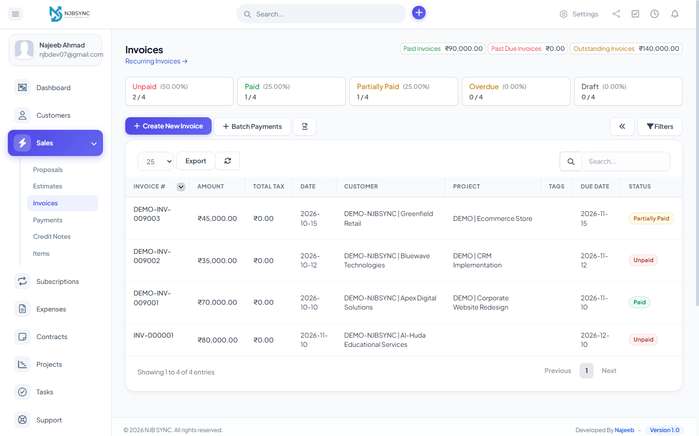

<br />

### 6. 📑 Estimates & Quotations
*Professional quotation builder with client approval tracking and instant one-click invoice conversion.*

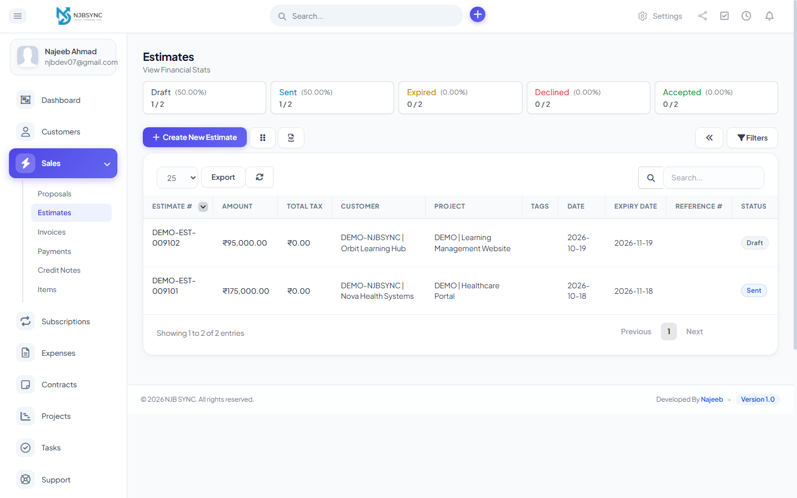

<br />

### 7. 📝 Proposals & Contracts
*Interactive digital proposals with online client feedback, acceptance, and electronic signatures.*

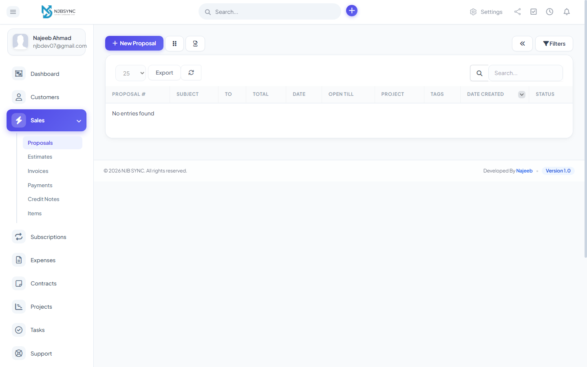

<br />

### 8. 📁 Project Management
*Comprehensive project workspace featuring milestones, task breakdown, file sharing, and discussion threads.*

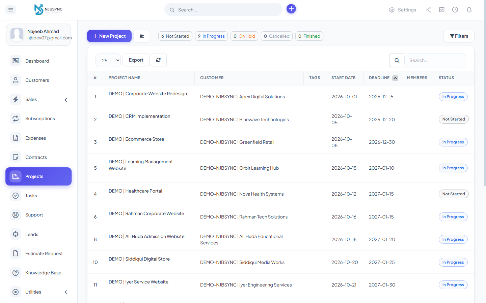

<br />

### 9. ⏱️ Tasks & Timesheet Tracking
*Kanban and table task views with built-in time tracking, checklists, and billable hour recording.*

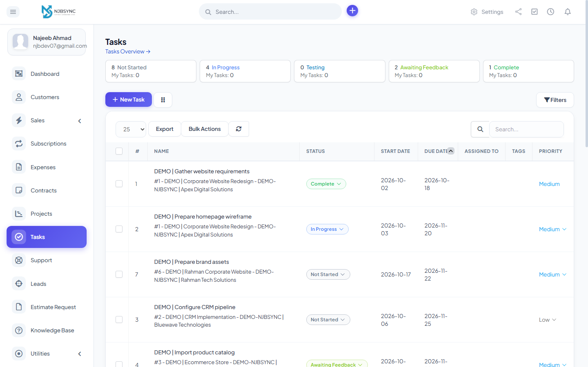

<br />

### 10. 🎫 Support Ticket Helpdesk
*Multi-department ticket routing, email piping, SLA management, and canned responses.*

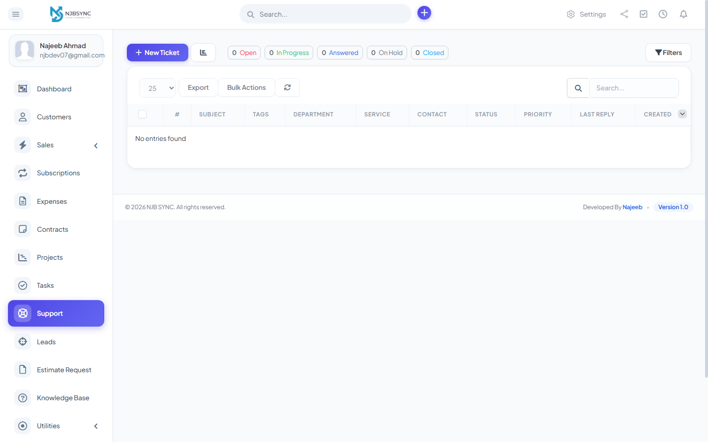

<br />

### 11. 📈 Financial Reports & Business Analytics
*Real-time profit & loss analytics, tax reports, sales summaries, and staff performance metrics.*

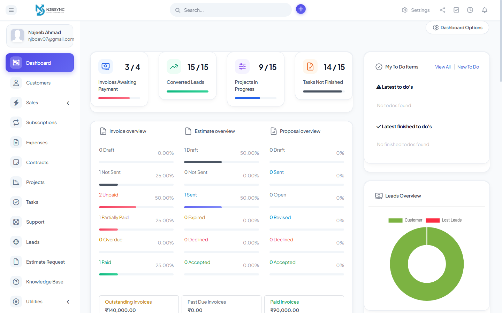

</div>

---

## 🚀 Features A to Z

| Letter | Feature | Description |
| :---: | :--- | :--- |
| **A** | **Authentication & 2FA** | Two-Factor Authentication via Google Authenticator, secure password resets, and session management. |
| **B** | **Billing & Subscriptions** | Recurring invoice cycles, automated payment reminders, and multi-currency billing. |
| **C** | **Customer 360° Portal** | Complete customer dossiers with contacts, invoices, estimates, files, and support history. |
| **D** | **Dashboard & KPI Cards** | Multi-metric KPI cards, untruncated progress stats, and customizable dashboard widgets. |
| **E** | **Estimates & E-Signatures** | Professional quotations convertible to invoices, and legally binding digital proposal signatures. |
| **F** | **Financial Overview** | Real-time tracking of paid, unpaid, partially paid, and overdue client invoices. |
| **G** | **GDPR Compliance** | Data export tools, right-to-be-forgotten customer removal, and consent logs. |
| **H** | **Helpdesk & Tickets** | Department ticket queues, internal staff notes, priority flags, and SLA monitoring. |
| **I** | **Invoicing & PDF Engine** | Auto-generate branded PDF invoices and send direct payment links to clients. |
| **J** | **Job & Task Scheduling** | Automated background Cron jobs for billing, reminder emails, and database maintenance. |
| **K** | **Kanban Boards** | Visual drag-and-drop boards for both Leads pipeline management and Task tracking. |
| **L** | **Leads Management** | Web-to-lead form generation, lead scoring, activity logs, and one-click customer conversion. |
| **M** | **Milestones & Projects** | Granular project roadmaps, Gantt timelines, file repositories, and team assignments. |
| **N** | **Notifications System** | Real-time desktop alerts, browser push notifications, and automated email dispatches. |
| **O** | **Online Payment Gateways** | Integrated support for Stripe, PayPal, Mollie, Authorize.net, and offline bank transfer. |
| **P** | **Proposals & Contracts** | Rich-text proposal builder with client review comments and contract expiry warnings. |
| **Q** | **Quick Actions Menu** | Global top bar navigation for quickly adding tasks, invoices, leads, or customers from any screen. |
| **R** | **Role-Based Access Control** | Granular staff permissions: restrict viewing, editing, or deleting by module and department. |
| **S** | **Sidebar Modern UI** | Prominent `34px` rounded icon containers with micro-interactions and smooth active pills. |
| **T** | **Timesheet Tracking** | In-app live stopwatch for tracking billable hours and automatically billing them to projects. |
| **U** | **Uploads & File Sharing** | Secure attachment vault for contracts, customer documents, project files, and ticket media. |
| **V** | **Version 1.0 Stability** | Clean, optimized CodeIgniter core architecture with isolated custom CSS overrides. |
| **W** | **Web-to-Lead Forms** | Embeddable lead capture forms with custom styling and auto-assignment rules. |
| **X** | **XML / CSV Data Exports** | Export customer tables, invoices, payments, and expenses to Excel, CSV, and PDF formats. |
| **Y** | **Yearly & Periodic Reports** | Detailed sales charts, expense breakdowns, and staff performance analytics. |
| **Z** | **Zero Monthly Fees** | Completely open-source, self-hosted, and free from subscription fees or vendor lock-in. |

---

## 📋 System Requirements

* **PHP:** `8.1` or `8.2` (PHP 7.4+ supported)
* **Database:** MySQL `5.7+` or MariaDB `10.3+`
* **Web Server:** Apache (with `mod_rewrite` enabled) or Nginx
* **Required PHP Extensions:** `curl`, `gd`, `mbstring`, `openssl`, `pdo_mysql`, `zip`, `xml`, `bcmath`, `fileinfo`
* **Memory Limit:** `128M` minimum (`256M` recommended)

---

## 🛠️ Installation Guide

### Option 1: Local Installation (XAMPP / WAMP / LAMP)

1. **Clone the Repository:**
   ```bash
   git clone https://github.com/najeebahmad07/crm.git c:\xampp\htdocs\crm
   ```

2. **Start Web & Database Servers:**
   * Open the XAMPP Control Panel.
   * Start **Apache** and **MySQL**.

3. **Create Database:**
   * Open `http://localhost/phpmyadmin` in your web browser.
   * Create a new database named `crm` with collation `utf8mb4_unicode_ci`.

4. **Configure Database Credentials:**
   * Copy `application/config/app-config-sample.php` to `application/config/app-config.php`.
   * Open `application/config/app-config.php` and configure:
     ```php
     define('APP_BASE_URL', 'http://localhost/crm/');

     define('APP_DB_HOSTNAME', 'localhost');
     define('APP_DB_USERNAME', 'root');
     define('APP_DB_PASSWORD', '');
     define('APP_DB_NAME', 'crm');
     define('APP_ENC_KEY', 'your-random-32-character-secret-key-here');
     ```

5. **Launch the Application:**
   * Navigate to:
     ```
     http://localhost/crm/admin/authentication
     ```

---

### Option 2: Production Server (Ubuntu / Linux VPS)

1. **Clone into Web Root:**
   ```bash
   cd /var/www/
   git clone https://github.com/najeebahmad07/crm.git crm
   cd crm
   ```

2. **Configure Folder Permissions:**
   ```bash
   chown -R www-data:www-data /var/www/crm
   chmod -R 755 /var/www/crm
   chmod -R 777 /var/www/crm/uploads
   chmod -R 777 /var/www/crm/temp
   chmod -R 777 /var/www/crm/application/config
   ```

3. **Apache VirtualHost (`/etc/apache2/sites-available/crm.conf`):**
   ```apache
   <VirtualHost *:80>
       ServerName crm.yourdomain.com
       DocumentRoot /var/www/crm

       <Directory /var/www/crm>
           Options FollowSymLinks
           AllowOverride All
           Require all granted
       </Directory>
   </VirtualHost>
   ```

4. **Nginx Server Block (`/etc/nginx/sites-available/crm`):**
   ```nginx
   server {
       listen 80;
       server_name crm.yourdomain.com;
       root /var/www/crm;
       index index.php index.html;

       location / {
           try_files $uri $uri/ /index.php?$query_string;
       }

       location ~ \.php$ {
           include snippets/fastcgi-php.conf;
           fastcgi_pass unix:/var/run/php/php8.2-fpm.sock;
       }
   }
   ```

---

## ⏱️ Cron Job Configuration

To automate recurring invoices, task reminders, overdue payment notices, and support email parsing, configure a recurring Cron job on your server:

```bash
# Run every 5 minutes (Recommended)
*/5 * * * * php /var/www/crm/index.php cron/index
```

Or via cPanel:
```
wget -q -O- https://yourdomain.com/crm/cron/index >/dev/null 2>&1
```

---

## 📁 Directory Structure

```plaintext
crm/
├── application/
│   ├── config/             # Database and application environment configs
│   ├── controllers/        # Core business and API controllers
│   ├── helpers/            # Menu, asset, and general helpers
│   ├── models/             # Database query and entity models
│   ├── views/
│   │   ├── admin/          # Admin portal views and widget modules
│   │   ├── authentication/ # Modern login and account security views
│   │   └── themes/perfex/  # Client portal templates and interfaces
├── assets/
│   ├── css/
│   │   └── custom.css      # Modern UI styling and component enhancements
│   ├── js/                 # Client and admin interactive scripts
│   └── plugins/            # DataTables, Chart.js, FontAwesome, etc.
├── modules/                # Modular extension directory
├── screenshots/            # Showcase images and UI previews
│   ├── 01_login.png
│   ├── 02_dashboard.png
│   ├── 03_customers.png
│   ├── 04_leads.png
│   ├── 05_invoices.png
│   ├── 06_estimates.png
│   ├── 07_proposals.png
│   ├── 08_projects.png
│   ├── 09_tasks.png
│   ├── 10_support_tickets.png
│   └── 11_reports.png
├── uploads/                # User avatars and attachments
├── .gitignore              # Git repository ignore rules
├── LICENSE                 # MIT Open Source License
├── README.md               # Documentation and showcase guide
└── index.php               # Application entrypoint
```

---

## 👨‍💻 Credits & License

* **Developer:** **Najeeb**
* **Version:** **1.0**
* **License:** [MIT License](LICENSE)

---

<div align="center">

Made with ❤️ by **Najeeb** • Version 1.0

</div>
